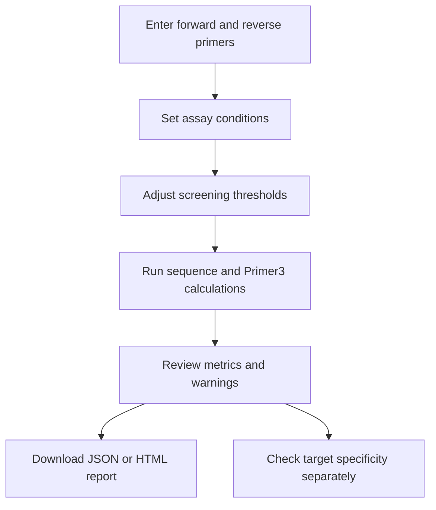

<div align="center">

# PrimerCheck Lite

### Understand your PCR and qRT-PCR primers before you go to the bench.

A beginner friendly, local tool for screening existing primer pairs, understanding common sequence metrics, setting your own screening limits, and exporting clear reports.

[](https://www.python.org/)
[](https://streamlit.io/)
[](https://primer3.org/)
[](LICENSE)

[Quick start](#quick-start) · [How it works](#how-it-works) · [Thresholds](#understand-the-thresholds) · [Reports](#reports) · [Limitations](#scientific-limitations)

</div>

---

## What can it do?

PrimerCheck Lite helps you review a pair of primers you already have. It calculates common sequence properties, estimates thermodynamic metrics with Primer3, compares the results with limits you choose, and explains which values may need a closer look.

| Feature | What you get |
|---|---|
| Sequence checks | Primer length, GC percentage, homopolymer runs, and the final five bases |
| Thermodynamic estimates | Melting temperature (Tm), hairpin Tm, homodimer Tm, and heterodimer Tm |
| Pair comparison | Difference between forward and reverse primer Tm |
| Optional template check | A simple search for one exact, inward facing amplicon on a supplied template |
| Editable limits | Set a minimum, a maximum, both, or neither for supported metrics |
| Exportable results | Download JSON data and a standalone HTML report |

> [!TIP]
> New to primer analysis? Start with the default limits, read the explanation under each metric, then adjust the values to match your assay protocol. Treat the results as a first screen, not a final approval.

## How it works



1. **Enter your primers.** Paste both sequences in the 5′ to 3′ direction.
2. **Set reaction conditions.** Provide the salt, dNTP, and primer concentrations used for the Tm estimates.
3. **Choose screening limits.** Edit the minimum and maximum values for each parameter.
4. **Review the results.** A warning means a metric falls outside your configured limits. It does not automatically mean the primer will fail.
5. **Save a report.** Download JSON for further processing or HTML for a readable record.

## Quick start

### 1. Create and activate a Python environment

Python 3.10 or newer is recommended.

```bash
python -m venv .venv
```

Activate it with the command for your operating system:

<details>
<summary><strong>macOS or Linux</strong></summary>

```bash
source .venv/bin/activate
```

</details>

<details>
<summary><strong>Windows PowerShell</strong></summary>

```powershell
.venv\Scripts\Activate.ps1
```

</details>

### 2. Install the project

Run these commands from the project directory:

```bash
python -m pip install --upgrade pip
pip install -e ".[ui,dev]"
```

### 3. Start the web app

```bash
streamlit run app.py
```

Streamlit prints a local URL in the terminal. Open that URL in your browser to use PrimerCheck Lite.

<details>
<summary><strong>What gets installed?</strong></summary>

- **Biopython** for DNA sequence utilities.
- **Primer3 via primer3-py** for thermodynamic estimates.
- **Streamlit** for the browser interface.
- **Typer and Rich** for the command line interface.
- **pytest and Ruff** for tests and code checks.

</details>

## Command line

You can run the same screening workflow from a terminal.

```bash
primerchecklite check \
  --forward ATGACCTACTTCGACGACGA \
  --reverse TCAGGATCTTGTCGATGTCG \
  --json-out report.json \
  --html-out report.html
```

### Include a template sequence

If you have a DNA template in FASTA format, you can provide it as an optional input:

```bash
primerchecklite check \
  --forward ATGACCTACTTCGACGACGA \
  --reverse TCAGGATCTTGTCGATGTCG \
  --template examples/synthetic_template.fasta
```

The template check looks for exact matches in the correct inward facing orientation. It is a limited check, not a genome wide specificity analysis.

## Understand the thresholds

The initial values are educational starting points. They are editable and should be chosen according to the assay, polymerase, buffer, instrument, target sequence, and validated laboratory protocol.

| Parameter | What it means | Default screening range |
|---|---|---:|
| Primer length | Number of nucleotides in a primer | 18 to 30 nt |
| GC percentage | Fraction of bases that are G or C | 40 to 60% |
| Tm | Estimated melting temperature | 57 to 63 °C |
| Hairpin Tm | Predicted stability of a folded primer | Maximum 45 °C |
| Homodimer Tm | Predicted interaction between copies of one primer | Maximum 45 °C |
| Heterodimer Tm | Predicted interaction between forward and reverse primers | Maximum 45 °C |
| Homopolymer run | Longest repeated run of one base | Maximum 4 bases |
| Tm difference | Absolute difference between forward and reverse Tm | Maximum 5 °C |
| Three prime GC count | Number of G or C bases in the final five nucleotides | 1 to 5 bases |

<details>
<summary><strong>Why are these limits editable?</strong></summary>

Primer performance depends on the target and the reaction chemistry. A threshold that is useful for one assay may not be appropriate for another. Use your lab's validated criteria where available. Do not treat the defaults as universal pass or fail rules.

Some metrics naturally use only a maximum. The interface lets you enable or disable a minimum and maximum independently, where supported.

</details>

## Reports

After analysis, you can export:

- **JSON report:** structured results that can be parsed or processed with Python.
- **HTML report:** a standalone browser report with primer metrics, threshold warnings, settings, and limitations.
- **Threshold settings:** a JSON copy of the limits you used, so the settings can be recorded alongside an experiment.

For reproducibility, keep the report with your primer sequence records and note the reaction conditions used for the estimates.

## Project structure

```text
primerchecklite/
├── app.py
├── pyproject.toml
├── README.md
├── LICENSE
├── CHANGELOG.md
├── CONTRIBUTING.md
├── CITATION.cff
├── prompt.md
├── src/
│   └── primerchecklite/
│       ├── __init__.py
│       ├── core.py
│       ├── cli.py
│       └── reporting.py
├── docs/
│   ├── scientific-methods.md
│   └── limitations.md
├── examples/
│   └── synthetic_template.fasta
└── tests/
    └── test_core.py
```

| File | Responsibility |
|---|---|
| `app.py` | Streamlit web interface and editable controls |
| `core.py` | Sequence checks, metrics, threshold evaluation, and template matching |
| `cli.py` | Terminal commands |
| `reporting.py` | JSON and HTML report generation |
| `docs/scientific-methods.md` | Description of the calculations and assumptions |
| `docs/limitations.md` | Known scientific limitations |
| `tests/test_core.py` | Automated tests for selected functions |

## Run the tests

Install the development dependencies, then run:

```bash
pytest
ruff check .
```

Tests and lint checks can catch code issues. They do not establish scientific validity or prove that a primer pair will work in a laboratory assay.

## Scientific limitations

PrimerCheck Lite is intended for preliminary screening. It does **not**:

- Design new primers from a target sequence.
- Search an entire genome for off target binding.
- Model all primer mismatches, insertions, deletions, or genetic variants.
- Predict experimental qPCR efficiency from measured amplification data.
- Prove that a primer pair will amplify the intended target.

A primer pair can fall within every selected range and still bind to an unintended sequence. A missing exact template match does not prove that amplification is impossible.

For target specificity checks, use [NCBI Primer BLAST](https://www.ncbi.nlm.nih.gov/tools/primer-blast/) or an appropriate in silico PCR workflow. Validate the final primers using your laboratory's assay conditions.

> [!WARNING]
> A clean report is not a validated assay. Use the tool to guide review, not as a substitute for specificity analysis, experimental controls, or an established laboratory protocol.

## Documentation

- [Scientific methods](docs/scientific-methods.md)
- [Limitations](docs/limitations.md)
- [Changelog](CHANGELOG.md)
- [Contributing](CONTRIBUTING.md)

## License

This project is distributed under the MIT License. See [LICENSE](LICENSE).
