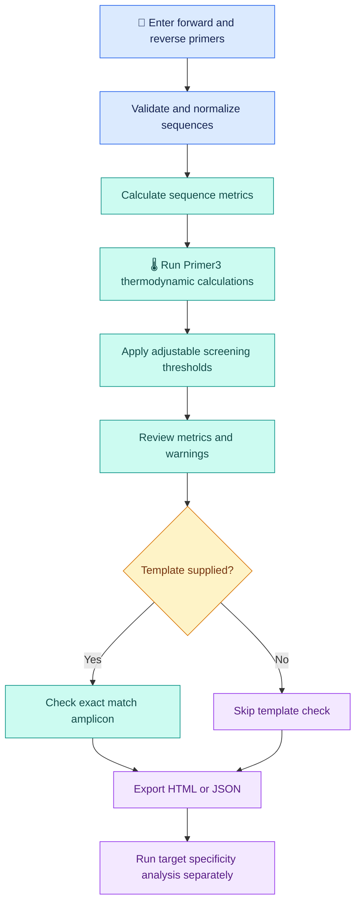

# 🧬 PrimerCheck Lite

<p align="center">
  
  
  
  
</p>

<p align="center">
  <b>Understand your primers before you take them to the lab.</b>
  <br>
  A local first screening toolkit for PCR primer pairs, with interpretable sequence metrics, thermodynamic predictions, adjustable thresholds, and downloadable reports.
</p>

<p align="center">
  <a href="https://github.com/Vishu1197/primerchecklite">Repository</a> ·
  <a href="https://github.com/Vishu1197/primerchecklite/issues">Report an issue</a> ·
  <a href="https://www.ncbi.nlm.nih.gov/tools/primer-blast/">Check target specificity</a>
</p>

---

## 🔬 What is PrimerCheck Lite?

PrimerCheck Lite is a Python based bioinformatics tool that helps researchers evaluate an existing forward and reverse PCR primer pair before target specific specificity analysis or experimental validation.

It combines sequence analysis, Primer3 thermodynamic calculations, configurable screening thresholds, and readable reports in one local workflow.

Instead of relying on a single pass or fail label, you can inspect individual metrics and understand which properties need further review.

### ✨ What can you check?

| Analysis | What it tells you |
|:--|:--|
| 🧬 Sequence validation | Checks and normalizes DNA primer sequences |
| 📏 Primer length | Counts nucleotides in each primer |
| 🧪 GC percentage | Calculates the fraction of G and C bases |
| 🌡️ Melting temperature | Estimates primer Tm with Primer3 |
| 🔁 Homopolymer runs | Detects consecutive repeats of the same nucleotide |
| 🪮 Hairpin structure | Estimates hairpin thermodynamic properties |
| 🔗 Homodimer formation | Evaluates predicted self dimer interactions |
| ↔️ Heterodimer formation | Evaluates predicted interactions between the forward and reverse primers |
| ⚖️ Tm difference | Calculates the absolute difference between primer Tm values |
| 🎯 Amplicon check | Optionally searches a supplied template for an exact match with one inward facing primer pair |

The warnings are screening heuristics. They help identify properties for review, but they do not establish whether a primer pair will work in the laboratory.

## 🚀 Why use it?

- **Local first workflow:** Analyze unpublished primer sequences locally by default.
- **Readable results:** Review measurements and plain language warnings together.
- **Adjustable screening:** Set thresholds and concentration assumptions for your analysis.
- **Two ways to work:** Use the command line or a local Streamlit interface.
- **Portable reports:** Export results as HTML or JSON.
- **Research oriented:** Read the methods, assumptions, and limitations behind the calculations.

PrimerCheck Lite is designed for first pass screening. It does not claim superior biological accuracy to established primer specificity tools.

## 🧰 Technology stack

The project uses Python libraries for sequence analysis, thermodynamic calculations, the user interface, command line interaction, and testing.

| Technology | Role in the project |
|:--|:--|
| [Python](https://www.python.org/) | Core programming language |
| [Biopython](https://biopython.org/) | DNA sequence handling and GC percentage calculations |
| [primer3-py](https://libnano.github.io/primer3-py/) | Primer thermodynamics, hairpin, and dimer calculations |
| [Typer](https://typer.tiangolo.com/) | Command line interface |
| [Rich](https://rich.readthedocs.io/) | Readable terminal output |
| [Streamlit](https://streamlit.io/) | Local interactive web interface |
| [pandas](https://pandas.pydata.org/) | Tabular data handling for the optional interface |
| [pytest](https://docs.pytest.org/) | Automated testing |
| [Ruff](https://docs.astral.sh/ruff/) | Python linting |
| [build](https://build.pypa.io/) | Python package build tooling |
| [GitHub Actions](https://github.com/features/actions) | Continuous integration workflow, as configured in the repository |

Core dependencies are Biopython, primer3-py, Typer, and Rich. Streamlit and pandas are installed with the `ui` extra. Pytest, Ruff, and build are installed with the `dev` extra.

## 🧭 How it works



The optional template check is limited to exact matching under the implemented search rules. It is not a substitute for genome wide alignment or off target analysis.

## 💻 Installation

### 1. Clone the repository

```bash
git clone https://github.com/Vishu1197/primerchecklite.git
cd primerchecklite
```

### 2. Create a virtual environment

```bash
python -m venv .venv
```

Activate it on Linux or macOS:

```bash
source .venv/bin/activate
```

On Windows PowerShell:

```powershell
.venv\Scripts\Activate.ps1
```

### 3. Install the project

```bash
python -m pip install --upgrade pip
pip install -e ".[ui,dev]"
```

This installs the project in editable mode, with the interface and development dependencies.

## 🖥️ Launch the local interface

Start the Streamlit application from the repository root:

```bash
streamlit run app.py
```

Open the local URL printed in the terminal.

The interface is intended to run locally. The default workflow does not require an account or upload primer sequences to a remote analysis service.

## ⌨️ Use the command line

### Screen a primer pair

```bash
primerchecklite check \
  --forward ATGACCTACTTCGACGACGA \
  --reverse TCAGGATCTTGTCGATGTCG \
  --json-out report.json \
  --html-out report.html
```

This command demonstrates the screening workflow and writes machine readable and HTML reports.

### Screen primers against a supplied template

```bash
primerchecklite check \
  --forward ATGACCTACTTCGACGACGA \
  --reverse TCAGGATCTTGTCGATGTCG \
  --template examples/synthetic_template.fasta \
  --json-out report.json \
  --html-out report.html
```

The template option checks for a qualifying exact match under the application's implemented rules. It does not establish biological specificity.

### Explore available options

```bash
primerchecklite check --help
```

The primer sequences above are software demonstration inputs. They are not validated primers for a particular organism or experimental target.

## 📊 Understanding the results

| Metric | Interpretation |
|:--|:--|
| Length | Number of nucleotides in the primer |
| GC percentage | Percentage of bases that are G or C |
| Estimated Tm | Primer3 predicted melting temperature under the selected settings |
| Hairpin Tm | Predicted thermodynamic metric for a hairpin structure |
| Homodimer Tm | Predicted self dimer metric |
| Heterodimer Tm | Predicted interaction metric for the primer pair |
| Homopolymer | Longest consecutive run of one nucleotide |
| Tm difference | Absolute difference between the two estimated Tm values |
| Amplicon length | Product length when a qualifying exact match is found on the supplied template |

Interpret predicted structure metrics according to the installed Primer3 version and the parameters used. Thresholds are user configurable screening criteria, not universal definitions of PCR success.

## 🎯 Specificity is a separate question

A primer pair can have acceptable length, GC percentage, and Tm while still amplifying unintended regions.

PrimerCheck Lite does not perform genome wide specificity analysis, off target alignment, or variant analysis.

For target specific validation, use [NCBI Primer BLAST](https://www.ncbi.nlm.nih.gov/tools/primer-blast/) or a suitable in silico PCR workflow against the correct organism and reference assembly. Experimental validation is still required.

## 🧪 Development and testing

Install the development dependencies:

```bash
pip install -e ".[dev,ui]"
```

Run the automated tests:

```bash
pytest
```

Check code style:

```bash
ruff check .
```

Build a distributable Python package:

```bash
python -m build
```

Review [CONTRIBUTING.md](CONTRIBUTING.md) before proposing changes. See [prompt.md](prompt.md) for the AI coding agent brief.

## 📚 Scientific methods and references

Read the project documentation before using the reported values to guide experimental decisions.

- [Scientific methods](docs/scientific-methods.md)
- [Limitations](docs/limitations.md)
- [Contributing guide](CONTRIBUTING.md)
- [Project changelog](CHANGELOG.md)

Scientific references:

1. Untergasser A, et al. Primer3: new capabilities and interfaces. *Nucleic Acids Research*. 2012;40(15):e115. [https://doi.org/10.1093/nar/gks596](https://doi.org/10.1093/nar/gks596)
2. [Biopython documentation](https://biopython.org/)
3. [primer3-py documentation](https://libnano.github.io/primer3-py/)
4. [NCBI Primer BLAST](https://www.ncbi.nlm.nih.gov/tools/primer-blast/)

Verify software versions, thermodynamic parameters, and the cited literature before reporting results in a publication.

## ⚠️ Current development status

PrimerCheck Lite is in early development.

- Review the scientific assumptions before relying on screening warnings.
- Run the test suite in a clean environment.
- Compare calculated values with the installed Primer3 version.
- Use an independent specificity workflow for biological targets.
- Validate candidate primers experimentally.

The software provides screening information. It does not guarantee amplification, specificity, or experimental success.

## 📄 License

Released under the MIT License. See [LICENSE](LICENSE).

## 🤝 Contributing

Contributions, bug reports, and scientific feedback are welcome through the repository's issue tracker and contribution guide.

[Open an issue](https://github.com/Vishu1197/primerchecklite/issues) · [Browse the source code](https://github.com/Vishu1197/primerchecklite)

---

<p align="center">
  <b>PrimerCheck Lite</b>
  <br>
  Clear primer metrics. Local analysis. Better informed experimental decisions.
</p>
