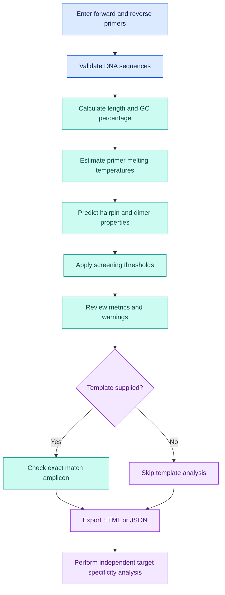

# 🧬 PrimerCheck Lite

<p align="center">
  
  
  
  
  
</p>

<p align="center">
  <b>Screen your primers. Inspect secondary structures. Understand the results.</b>
  <br>
  A local first PCR primer screening toolkit with interpretable metrics, adjustable thresholds, and downloadable reports.
</p>

<p align="center">
  <a href="https://github.com/Vishu1197/primerchecklite">Source code</a> ·
  <a href="https://github.com/Vishu1197/primerchecklite/issues">Report a bug</a> ·
  <a href="https://www.ncbi.nlm.nih.gov/tools/primer-blast/">NCBI Primer BLAST</a>
</p>

---

## 🔬 What is PrimerCheck Lite?

PrimerCheck Lite is a Python based bioinformatics application for screening an existing forward and reverse PCR primer pair before target specificity analysis and experimental validation.

It combines DNA sequence validation, GC content analysis, Primer3 thermodynamic calculations, screening thresholds, and downloadable reports in one local workflow.

A primer pair can have an acceptable length, GC percentage, and melting temperature while still forming undesirable secondary structures. PrimerCheck Lite helps researchers inspect these properties before proceeding to more complete specificity checks.

### ✨ Key features

| Feature | Description |
|:--|:--|
| 🧬 Sequence validation | Normalizes and validates DNA primer sequences |
| 📏 Primer length | Counts nucleotides in each primer |
| 🧪 GC percentage | Calculates the percentage of G and C bases |
| 🌡️ Melting temperature | Estimates primer Tm under the selected settings |
| 🪮 Hairpin analysis | Predicts the thermodynamic melting temperature associated with a hairpin structure |
| 🔗 Homodimer analysis | Evaluates predicted interactions between copies of the same primer |
| ↔️ Heterodimer analysis | Evaluates predicted interactions between forward and reverse primers |
| 🧩 Self complementarity | Helps identify sequence complementarity that can contribute to unwanted structures |
| 🔬 Homopolymer analysis | Detects consecutive runs of the same nucleotide |
| ⚖️ Tm difference | Calculates the absolute difference between forward and reverse primer Tm |
| 🎯 Template check | Optionally checks for an exact match amplicon on a supplied template |
| 🖥️ Local interface | Provides a Streamlit interface for interactive screening |
| ⌨️ Command line | Supports scripted analysis from a terminal |
| 📄 Reports | Exports HTML and JSON reports |

The exact metrics available in a report depend on the implemented calculation and the installed Primer3 version. Hairpin and dimer melting temperatures are thermodynamic estimates, not direct measurements of experimental behavior.

## 🧰 Technology stack

PrimerCheck Lite uses Python libraries for sequence processing, thermodynamic calculations, command line interaction, the local interface, and automated testing.

| Library or technology | Purpose |
|:--|:--|
| [Python](https://www.python.org/) | Core programming language |
| [Biopython](https://biopython.org/) | DNA sequence handling and GC percentage calculations |
| [primer3-py](https://libnano.github.io/primer3-py/) | Primer melting temperature, hairpin, homodimer, and heterodimer calculations |
| [Typer](https://typer.tiangolo.com/) | Command line interface |
| [Rich](https://rich.readthedocs.io/) | Formatted terminal output |
| [Streamlit](https://streamlit.io/) | Local interactive web interface |
| [pandas](https://pandas.pydata.org/) | Tabular data handling for the interface |
| [pytest](https://docs.pytest.org/) | Automated testing |
| [Ruff](https://docs.astral.sh/ruff/) | Python linting |
| [build](https://build.pypa.io/) | Python package building |
| [GitHub Actions](https://github.com/features/actions) | Automated checks, as configured in the repository |

Core dependencies and optional dependency groups are defined in `pyproject.toml`.

## 🧭 How the workflow works



The workflow is designed for inspecting a primer pair already in hand. It does not search complete genomes or replace a target specific PCR validation workflow.

## 🆚 PrimerCheck Lite vs NCBI Primer BLAST

PrimerCheck Lite and [NCBI Primer BLAST](https://www.ncbi.nlm.nih.gov/tools/primer-blast/) have different primary workflows.

PrimerCheck Lite emphasizes local screening and report generation for an existing primer pair. Primer BLAST combines primer design and evaluation with BLAST based searches to investigate potential unintended amplification against selected sequence databases.

### Feature comparison

| Capability | PrimerCheck Lite | NCBI Primer BLAST |
|:--|:--|:--|
| Inspect an existing primer pair | Yes | Yes |
| Primer length, GC percentage, and Tm | Yes | Yes |
| Hairpin thermodynamic calculation | Available through Primer3 based calculations | Supported by the primer evaluation workflow |
| Self complementarity assessment | Reports predicted homodimer properties; separate complementarity scores depend on implementation | Supports self complementarity and self 3′ complementarity criteria |
| Forward and reverse primer interaction | Reports predicted heterodimer properties | Supports primer pair complementarity criteria |
| Adjustable screening thresholds | Supported for implemented settings | Supports primer design and evaluation settings |
| Local analysis without sending sequences to a remote service | Yes, in the local workflow | No, the query is submitted to NCBI |
| Local HTML and JSON reports | Yes | Provides its own web based results |
| Genome wide specificity analysis | Not implemented | Supported against selected reference databases |
| Off target alignments and potential unintended products | Not implemented | Can report potential unintended targets |

Primer BLAST already provides secondary structure and complementarity related criteria. PrimerCheck Lite does not claim to calculate these properties more accurately.

### Where PrimerCheck Lite is useful

**1. Focused screening of existing primers**

If you already have a forward and reverse primer pair, you can enter both sequences and inspect their properties without first setting up a primer design query.

**2. Hairpin and dimer inspection**

Hairpins occur when a single primer folds back and forms an intramolecular structure. Homodimers form between copies of the same primer, while heterodimers form between different primers.

These structures can compete with binding to the intended template. PrimerCheck Lite reports predicted thermodynamic metrics that help identify structures for further review.

**3. Local analysis of unpublished sequences**

The local interface and CLI are intended to run on your own machine. This can be useful when screening unpublished sequences that you do not want to submit to an external service.

**4. Portable reports**

Save an HTML report for human review or JSON for programmatic processing and research records.

**5. Adjustable screening criteria**

Use the implemented thresholds and concentration assumptions to inspect how the screening results change with the selected settings.

### Which tool should you use?

| Research objective | Recommended workflow |
|:--|:--|
| Quickly inspect a primer pair already in hand | PrimerCheck Lite |
| Review predicted hairpin and dimer properties locally | PrimerCheck Lite |
| Keep unpublished sequences within a local workflow | PrimerCheck Lite |
| Design primers for a specified target sequence | NCBI Primer BLAST or another validated primer design tool |
| Investigate possible genome wide off target amplification | NCBI Primer BLAST or validated in silico PCR |
| Confirm actual PCR performance | Experimental validation |

The two tools can be used together. Screen the physical properties of an existing primer pair, then use Primer BLAST or a suitable in silico PCR workflow to assess target specificity.

## 🪮 Understanding hairpins and primer dimers

Secondary structure analysis is one of the main screening functions in PrimerCheck Lite.

### Hairpin formation

A hairpin forms when complementary regions within one primer bind to each other, creating a stem and loop.

```text
5'  G C A T G C T A A G C A T G C  3'
       | | | |       | | | |
       stem          stem

Illustrative concept only, not a calculated structure.
```

A stable hairpin can reduce the fraction of primer available to bind the intended template. Primer3 estimates the thermodynamic properties of possible hairpin structures.

### Homodimer formation

A homodimer forms when two copies of the same primer interact through complementary bases.

This can consume primer molecules and may interfere with productive amplification.

### Heterodimer formation

A heterodimer forms when the forward and reverse primers interact with each other. Complementarity near the 3′ ends is of particular interest because an extendable primer dimer may compete with target amplification.

### Self complementarity

Self complementarity describes a primer's tendency to form complementary interactions. Depending on the calculation, the result may be a sequence alignment score or a thermodynamic estimate.

These metrics are related but not interchangeable. A homodimer melting temperature is not the same as a conventional self complementarity score. Check the report labels and scientific methods documentation for the exact quantities calculated by the application.

A predicted structure does not automatically mean that PCR will fail. Experimental conditions, primer concentrations, salt concentrations, and polymerase chemistry can affect the observed outcome.

## 📊 Understanding the reported metrics

| Metric | Meaning |
|:--|:--|
| Length | Number of nucleotides in a primer |
| GC percentage | Percentage of primer bases that are G or C |
| Estimated Tm | Predicted melting temperature under the selected thermodynamic settings |
| Hairpin Tm | Predicted melting temperature associated with a hairpin structure |
| Homodimer Tm | Predicted thermodynamic metric for interactions between copies of one primer |
| Heterodimer Tm | Predicted thermodynamic metric for interactions between the forward and reverse primers |
| Homopolymer | Longest consecutive run of the same nucleotide |
| Tm difference | Absolute difference between forward and reverse primer Tm values |
| Amplicon length | Product length when a qualifying exact match pair is found on the supplied template |

Warnings are screening heuristics. They identify properties for review and are not proof of failure.

## 💻 Installation

Python 3.10 or later is recommended.

### 1. Clone the repository

```bash
git clone https://github.com/Vishu1197/primerchecklite.git
cd primerchecklite
```

### 2. Create a virtual environment

```bash
python -m venv .venv
```

On Linux or macOS:

```bash
source .venv/bin/activate
```

On Windows PowerShell:

```powershell
.venv\Scripts\Activate.ps1
```

### 3. Install dependencies

```bash
python -m pip install --upgrade pip
pip install -e ".[ui,dev]"
```

This installs the project in editable mode with the user interface and development dependencies.

## 🖥️ Launch the Streamlit interface

Run the following command from the project root:

```bash
streamlit run app.py
```

Open the local URL printed in your terminal.

The application is designed to perform its analysis locally. The default workflow does not require an account or uploading primer sequences to a remote analysis service.

## ⌨️ Use the command line

### Screen a primer pair

```bash
primerchecklite check \
  --forward ATGACCTACTTCGACGACGA \
  --reverse TCAGGATCTTGTCGATGTCG \
  --json-out report.json \
  --html-out report.html
```

This example demonstrates the command line workflow and report generation. The sequences are demonstration inputs and have not been validated for a biological target.

### Check an optional template

```bash
primerchecklite check \
  --forward ATGACCTACTTCGACGACGA \
  --reverse TCAGGATCTTGTCGATGTCG \
  --template examples/synthetic_template.fasta \
  --json-out report.json \
  --html-out report.html
```

The template check looks for a qualifying exact match amplicon according to the implemented rules. It does not establish genome wide specificity.

### View all command options

```bash
primerchecklite check --help
```

## 📄 Reports and reproducibility

PrimerCheck Lite supports two report formats.

| Format | Intended use |
|:--|:--|
| HTML | Human readable screening report |
| JSON | Machine readable results for further analysis |

For reproducibility, record the primer sequences, analysis settings, concentration assumptions, and software versions associated with each report.

A report is a record of the calculations performed under the selected settings. It is not a certificate of primer specificity or experimental performance.

## 🧪 Development and testing

Install the development dependencies:

```bash
pip install -e ".[dev,ui]"
```

Run automated tests:

```bash
pytest
```

Check code style:

```bash
ruff check .
```

Build a Python distribution:

```bash
python -m build
```

See [CONTRIBUTING.md](CONTRIBUTING.md) for contribution guidance and [prompt.md](prompt.md) for the AI coding agent brief.

## ⚠️ Scientific limitations

PrimerCheck Lite is an early development project and should be evaluated before use in research decisions.

- It does not perform genome wide specificity analysis.
- It does not identify off target alignments against a genome database.
- It does not account for all possible sequence variants.
- Exact match template analysis is limited to the implemented matching rules.
- Thermodynamic predictions depend on the Primer3 implementation, version, and selected parameters.
- Screening thresholds are heuristics and do not guarantee amplification.
- Predicted hairpins and dimers do not establish experimental failure.
- Results should be checked against independent tools and experimental data before publication.

For target specificity analysis, use [NCBI Primer BLAST](https://www.ncbi.nlm.nih.gov/tools/primer-blast/) with the appropriate organism and reference database.

## 📚 Scientific methods and references

Project documentation:

- [Scientific methods](docs/scientific-methods.md)
- [Limitations](docs/limitations.md)
- [Contributing guide](CONTRIBUTING.md)
- [Project repository](https://github.com/Vishu1197/primerchecklite)

Scientific references:

1. Untergasser A, et al. Primer3: new capabilities and interfaces. *Nucleic Acids Research*. 2012;40(15):e115. [https://doi.org/10.1093/nar/gks596](https://doi.org/10.1093/nar/gks596)
2. [Primer3 manual](https://primer3.org/manual.html)
3. [primer3-py documentation](https://libnano.github.io/primer3-py/)
4. [Biopython documentation](https://biopython.org/)
5. [NCBI Primer BLAST](https://www.ncbi.nlm.nih.gov/tools/primer-blast/)

Verify software versions, calculation parameters, and reference details before citing PrimerCheck Lite or its results in a publication.

## 📜 License

PrimerCheck Lite is released under the MIT License. See [LICENSE](LICENSE).

## 🤝 Contributing

Bug reports, code contributions, and scientific feedback are welcome.

Visit the [GitHub repository](https://github.com/Vishu1197/primerchecklite) to review the source code or open an [issue](https://github.com/Vishu1197/primerchecklite/issues).

<p align="center">
  <b>PrimerCheck Lite</b>
  <br>
  Local primer screening, interpretable metrics, and thermodynamic analysis.
</p>
